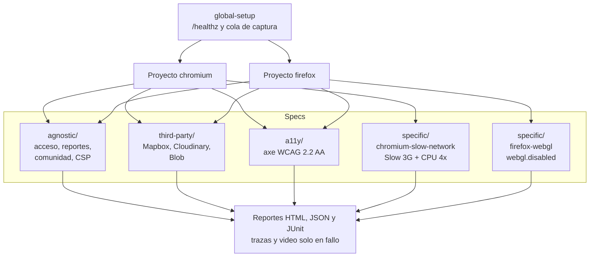

# 4.4.1 Pruebas end-to-end de navegador

Las pruebas end-to-end (E2E) recorren la web como lo haría un vecino: abren el navegador, inician sesión, publican un reporte, comentan y votan. Corren contra el stack completo (web, gateway, siete microservicios, PostgreSQL y RabbitMQ), de modo que cada prueba atraviesa el frontend, el gateway, los servicios y la mensajería real.

## Diseño

**Herramienta y navegadores.** Se usó Playwright 1.55 con dos motores distintos: **Chromium** (Blink, la base de Chrome y Edge) y **Firefox** (Gecko). Son los dos motores de escritorio con más usuarios después de WebKit. Además, sus diferencias reales afectan a PeaceApp: WebGL para el mapa, permisos de geolocalización y APIs de depuración.

**Dos clases de prueba.**

- **Browser-agnostic:** describen un comportamiento que debe ser idéntico en cualquier navegador y corren en ambos proyectos sin cambios. Cubren acceso, reportes, comunidad, la política de seguridad de contenido (CSP), los terceros simulados (sección 4.4.2) y la accesibilidad (sección 4.4.5).
- **Browser-specific:** usan una capacidad que solo existe en un motor y se saltan explícitamente en el otro, con el motivo anotado en el reporte.
  - En Chromium se usa el Chrome DevTools Protocol (CDP) para emular una red Slow 3G y una CPU cuatro veces más lenta.
  - En Firefox se usa `firefoxUserPrefs` para apagar WebGL, como ocurre en equipos con drivers bloqueados o escritorios remotos.

**Principios.**

- **Localizadores accesibles.** Se usan `getByRole` y `getByLabel` en lugar de selectores CSS, así que la prueba falla si un control pierde su nombre accesible. Esto conecta 4.4.1 con 4.4.5.
- **Datos aislados por prueba.** Cada prueba crea sus propios usuarios (`<prefijo>-<id>@peaceapp.test`) por la API, de modo que las pruebas se pueden ejecutar en paralelo y en cualquier orden.
- **Verificación de correo sin correo.** El gateway exige correo verificado para publicar, votar y comentar. La suite lee el código de verificación del evento `notification.email-requested`, mediante una cola propia en RabbitMQ, igual que lo haría el servicio de notificaciones.
- **Terceros simulados.** Mapbox, Cloudinary y Azure Blob se interceptan en el navegador. La prueba no depende de internet ni de cuotas (sección 4.4.2).

**Figura 2**  
*Organización de la suite de Playwright*

## Implementación

La suite está en `peaceapp-platform/tests/e2e`. Los *fixtures* de `support/fixtures.js` extienden el `test` de Playwright con `user` (usuario verificado), `signedInPage` (página con la sesión iniciada en localStorage) y `thirdParty` (stubs de terceros activos en todas las pruebas). La configuración fija la zona horaria de Lima, el idioma `es-PE` y una geolocalización en Lima, para que las fechas y el mapa sean deterministas.

**Tabla 1**  
*Inventario de pruebas E2E*

| Archivo | Clase | Pruebas | Qué verifica |
|---|---|---|---|
| `agnostic/auth.spec.js` | Agnostic | 4 | Ruta protegida que redirige y conserva el destino; registro desde la UI con verificación del correo; credenciales incorrectas con error accesible; inicio y cierre de sesión |
| `agnostic/reports.spec.js` | Agnostic | 3 | Publicar con dirección geocodificada; filtrar el listado y abrir el detalle; el mapa carga los reportes de la zona |
| `agnostic/community.spec.js` | Agnostic | 2 | Un vecino comenta y vota el reporte de otra persona (1 de 3 confirmaciones); el autor no puede votar ni denunciar su propio reporte |
| `agnostic/csp.spec.js` | Agnostic | 2 | La web envía la CSP y ninguna de las 7 pantallas la viola (sección 4.4.4) |
| `third-party/integrations.spec.js` | Agnostic | 7 | Contrato y fallas de Mapbox, Azure Blob y Cloudinary (sección 4.4.2) |
| `a11y/screens.spec.js` | Agnostic | 14 | axe en 10 pantallas y 4 revisiones dirigidas (sección 4.4.5) |
| `specific/chromium-slow-network.spec.js` | Solo Chromium | 1 | Con Slow 3G y CPU 4x el login aparece en menos de 15 s y el botón muestra el estado de espera (`aria-busy`) |
| `specific/firefox-webgl.spec.js` | Solo Firefox | 2 | Sin WebGL, el mapa explica por qué no se muestra y se puede publicar un reporte con la ubicación del navegador |

## Defectos encontrados

Las pruebas específicas de navegador encontraron un defecto que las agnósticas no podían ver:

- **Firefox sin WebGL.** `new mapboxgl.Map(...)` lanza una excepción cuando WebGL no está disponible.
  - En el mapa, la excepción se perdía y la pantalla decía "0 reportes", como si no hubiera incidentes en la zona.
  - En el formulario, la excepción ocurría antes de fijar la posición, así que la latitud quedaba vacía y **era imposible publicar un reporte**.
  - La corrección envuelve la creación del mapa. El mapa muestra un aviso (`role="alert"`) con un enlace al listado, y el formulario usa la ubicación del navegador con la dirección editable.

La prueba de red lenta no encontró defectos, pero dejó una línea base: con Slow 3G y CPU 4x, **el login es visible a los 5,97 s** y el recorrido de iniciar sesión hasta ver el mapa toma **31,0 s**.

## Ejecución

- **CI:** workflow `advanced-tests.yml` de `peaceapp-platform`. Se ejecuta manualmente (con ramas elegibles de servicios y web), cada lunes a la 01:00 de Lima y en cada PR que toque la suite o los compose. Clona los repositorios de los servicios, levanta el stack con `docker compose ... up --build --wait`, instala Chromium y Firefox y ejecuta `npx playwright test`. Los reportes HTML, JSON y JUnit se publican como artefacto durante 30 días. Un fallo no detiene las demás pruebas: el gate se evalúa al final.
- **Local:** `npx playwright test` dentro de `tests/e2e`, con `WEB_URL` apuntando a la web del compose.
- **Reintentos y paralelismo:** `retries: 0` y 4 *workers* en local; `retries: 1` y 2 *workers* en CI, por los 2 vCPU del runner. Una prueba que pasa al reintentar queda marcada como *flaky* en el reporte; no se oculta. `forbidOnly` impide que un `test.only` olvidado deje la suite a medias en CI.

## Resultados

**Tabla 2**  
*Resultados por navegador (ejecución local del 26 de noviembre de 2026, después de las correcciones)*

| Navegador | Pruebas | Aprobadas | Fallidas | Omitidas (otro navegador) | Flaky | Tiempo acumulado |
|---|---|---|---|---|---|---|
| Chromium | 35 | 33 | 0 | 2 | 0 | 159,3 s |
| Firefox | 35 | 34 | 0 | 1 | 0 | 224,6 s |
| **Total** | **70** | **67** | **0** | **3** | **0** | 117,0 s en paralelo |

**Tabla 3**  
*Pruebas que fallaban antes de las correcciones*

| Prueba | Navegador | Antes | Después | Corrección |
|---|---|---|---|---|
| El mapa explica que no puede mostrarse | Firefox | Falla | Pasa | Aviso accesible sin WebGL |
| Se puede publicar un reporte con la ubicación del navegador | Firefox | Falla | Pasa | Posición fijada aunque el mapa no exista |
| Cloudinary caído (500) | Ambos | Falla | Pasa | Mensaje propio del error de subida (4.4.2) |
| axe y revisión dirigida | Ambos | 5 pantallas y 4 revisiones fallan | Pasan | Sección 4.4.5 |

Firefox tarda en promedio 1,4 veces más que Chromium en las mismas pruebas, sobre todo en las de accesibilidad, porque axe recorre el DOM más lento en Gecko. La diferencia no cambia ningún resultado.

## Oportunidades de mejora

- **WebKit (Safari).** Muchos vecinos usan iPhone, y Safari en iOS solo usa WebKit. No se incluyó porque WebKit en Linux sin GPU no inicializa bien el WebGL de Mapbox y el runner gratuito tiene 2 vCPU. Conviene agregarlo con el mapa simulado o en un runner macOS.
- **Viewport móvil.** La mayoría de los reportes se hará desde el celular. Un proyecto con `devices['Pixel 7']` detectaría problemas de diseño responsivo.
- **Regresión visual.** `toHaveScreenshot()` en las pantallas principales detectaría cambios de estilo, como los de contraste corregidos en 4.4.5.
- **E2E en el PR de la web.** Hoy la suite vive en `peaceapp-platform`. Un subconjunto de humo en el pipeline de `PeaceApp-AppWeb` daría retroalimentación antes del merge.

## Referencias técnicas

Microsoft. (s. f.). *Playwright: Browsers*. Playwright. https://playwright.dev/docs/browsers

Microsoft. (s. f.). *Playwright: Locators*. Playwright. https://playwright.dev/docs/locators

Microsoft. (s. f.). *Playwright: Test retries*. Playwright. https://playwright.dev/docs/test-retries

Mapbox. (s. f.). *Mapbox GL JS: Browser support*. Mapbox Docs. https://docs.mapbox.com/mapbox-gl-js/guides/browsers-and-testing/
