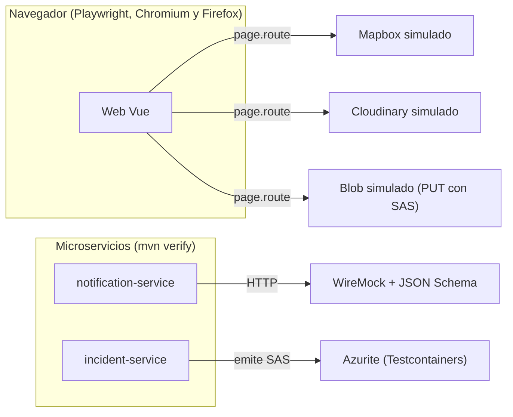

# 4.4.2 Pruebas de integración con servicios de terceros

PeaceApp depende de cuatro servicios externos. Dos se llaman desde el backend y dos solo desde el navegador; Azure Blob Storage participa en ambos lados, porque el servicio de incidentes firma la URL y el navegador sube la imagen directamente.

**Tabla 4**  
*Servicios de terceros y técnica de prueba aplicada*

| Servicio | Uso en PeaceApp | Quién lo llama | Técnica | Ubicación de la prueba |
|---|---|---|---|---|
| Resend | Correos de verificación, recuperación y alertas | `notification-service` | Stub HTTP con WireMock + contrato en JSON Schema | `notification-service/src/test/.../ResendProviderIntegrationTest.java` |
| Azure Blob Storage | Evidencias fotográficas con URL firmada (SAS) | `incident-service` (firma) y navegador (subida) | Emulador oficial Azurite en Testcontainers; `page.route` en el navegador | `incident-service/src/test/.../EvidenceStorageAzuriteTest.java`, `peaceapp-platform/tests/e2e/specs/third-party` |
| Mapbox | Mapa, estilo y geocodificación inversa | Navegador | `page.route` con un estilo mínimo versionado | `peaceapp-platform/tests/e2e/specs/third-party` |
| Cloudinary | Foto de perfil | Navegador | `page.route` | `peaceapp-platform/tests/e2e/specs/third-party` |

## Diseño

Ninguna prueba llama al servicio real. Los proveedores cobran por uso, limitan la tasa de peticiones, requieren secretos y no permiten provocar a voluntad un error 503 o una conexión cortada, que son justamente los casos que se quieren comprobar. En su lugar se usan dobles de prueba, elegidos según lo que se necesita demostrar:

- **Stub verificable (WireMock) para Resend.** Responde lo que la prueba programa (200, 422, 429, 503, retrasos o conexión reseteada) y registra cada petición recibida. Así se verifica lo que envía el servicio (cabeceras, cuerpo, número de intentos) y cómo reacciona ante cada falla.
- **Contrato del lado consumidor.** El cuerpo enviado a Resend se valida contra un JSON Schema construido a partir de la documentación pública de la API (`from`, `to[]`, `subject`, `html`, `text`, sin propiedades adicionales). Si el servicio cambia el formato del mensaje, la prueba falla antes de llegar a producción.
- **Emulador en lugar de mock para Azure Blob.** Lo importante del SAS no es su texto, sino que el almacenamiento aplique sus permisos. Un mock no demuestra eso; Azurite, el emulador oficial de Microsoft, valida la firma, los permisos y el vencimiento igual que Azure.
- **Intercepción en el navegador.** Playwright intercepta con `page.route` las peticiones a `api.mapbox.com`, `api.cloudinary.com` y `*.blob.core.windows.net`. Cada intercepción comprueba lo que el front envía (método, cabeceras como `x-ms-blob-type: BlockBlob` y campos como `upload_preset`) y permite inyectar fallas: token rechazado, SAS rechazado, timeout o error 500.

**Figura 4**  
*Ubicación de los dobles de prueba respecto de cada servicio externo*



## Implementación

### Resend (notification-service)

`ResendProviderIntegrationTest` levanta el servicio completo (`@SpringBootTest`) con PostgreSQL y RabbitMQ en Testcontainers y apunta el cliente de Resend a WireMock mediante `@DynamicPropertySource`. Cada prueba publica el evento `notification.email-requested` en RabbitMQ y espera el resultado en la base de datos, de modo que se ejerce el recorrido real: listener, reintentos, emisor HTTP y persistencia.

**Tabla 5**  
*Escenarios de integración con Resend*

| Escenario | Respuesta simulada | Resultado esperado |
|---|---|---|
| Contrato de la petición | 200 con `id` | Cuerpo válido según el esquema; `Authorization: Bearer`, `Idempotency-Key` igual al `eventId` y `User-Agent` presentes; se guarda el id del proveedor |
| Errores transitorios | 503, luego 429, luego 200 | Tres intentos con la misma `Idempotency-Key`; el correo queda enviado |
| Proveedor lento | 200 con 2 s de retraso (read timeout de 800 ms) | Se reintenta |
| Conexión cortada | `CONNECTION_RESET_BY_PEER` | Se reintenta |
| Rechazo permanente | 422 | Un solo intento; estado `FAILED`; el cuerpo de la respuesta del proveedor no se guarda |
| Caída sostenida | 500 en todos los intentos | Cuatro intentos, estado `FAILED` y evento en la cola de mensajes muertos (DLQ) |

La primera ejecución encontró un defecto real: los escenarios de proveedor lento y conexión cortada fallaron (Figura 5). Cuando el tiempo de espera o el corte ocurren mientras se lee la respuesta, Spring lanza `RestClientException` y no `ResourceAccessException`. El emisor solo trataba esta última como reintentable, así que el correo terminaba en la DLQ sin reintentarse. La corrección clasifica `RestClientException` como reintentable. Reintentar es seguro porque cada envío lleva `Idempotency-Key` y Resend descarta los duplicados.

**Figura 5**  
*Ejecución en rojo y en verde de la integración con Resend*

```text
Antes:   Tests run: 6, Failures: 0, Errors: 2  (aDroppedConnectionIsRetried,
         aProviderSlowerThanTheReadTimeoutIsRetried: la condición no se cumplió en 20 s)
Después: Tests run: 6, Failures: 0, Errors: 0, Skipped: 0, Time elapsed: 18.58 s
```

### Azure Blob Storage (incident-service)

`EvidenceStorageAzuriteTest` levanta Azurite 3.35.0 con Testcontainers y usa la cuenta pública de desarrollo del emulador. Para que el servicio pudiera apuntar a Azurite se agregó la propiedad opcional `incident.evidence.storage.endpoint`. Su valor por defecto sigue siendo `https://<cuenta>.blob.core.windows.net` y el SAS sigue siendo solo HTTPS, de modo que producción no cambia.

**Tabla 6**  
*Escenarios de integración con Azure Blob Storage*

| Escenario | Qué se intenta | Respuesta del almacenamiento |
|---|---|---|
| SAS de subida | `PUT` de la imagen | 201 |
| SAS de subida | `GET` y `DELETE` con la misma URL | 403 y 403 |
| SAS de subida en otro blob | Reutilizar la firma para otro nombre | 403 |
| SAS de subida en el contenedor saneado | Escribir directo en `evidences-sanitized`, saltándose la función que elimina los metadatos EXIF | 403 |
| SAS de lectura | `GET` de la evidencia saneada | 200, mismo contenido |
| SAS de lectura | `PUT` y `DELETE` | 403 y 403 |
| Sin SAS | `GET` anónimo | 403 o 404 (contenedor privado) |
| SAS vencido o alterado | Subir con un SAS vencido; leer cambiando `sp=cw` por `sp=racwd` | 403 |

Para comprobar que las pruebas detectan regresiones se aplicó una mutación manual: agregar el permiso de lectura al SAS de subida. Con ese cambio, 2 de las 5 pruebas fallaron (el `GET` con el SAS de subida respondió 200). Esto confirma que un permiso de más, que expondría las evidencias sin sanear, no pasaría desapercibido.

### Mapbox, Cloudinary y Blob desde el navegador

`tests/e2e/support/third-party.js` define los stubs. Su modo (`ok`, `unauthorized`, `error` o `timeout`) se elige por prueba con la opción `thirdPartyModes`. Además de responder, cada stub registra las llamadas para que la prueba verifique lo que envió el front.

**Tabla 7**  
*Escenarios de terceros en el navegador*

| Tercero | Escenario | Verificación |
|---|---|---|
| Mapbox | El mapa pide el estilo y la geocodificación | Las peticiones usan el token público de runtime (`/config.js`) |
| Mapbox | Token rechazado (401) | La dirección cae a coordenadas y el reporte se puede publicar igual |
| Azure Blob | Subida de evidencia | `PUT` directo con `x-ms-blob-type: BlockBlob` y SAS `sp=cw`; vista previa visible |
| Azure Blob | SAS rechazado (403) y timeout de red | Mensaje de error y formulario usable |
| Cloudinary | Foto de perfil | `multipart/form-data` con `file` y `upload_preset`; se guarda la `secure_url` |
| Cloudinary | Servicio caído (500) | Mensaje de error y la foto no cambia |

La prueba de Cloudinary caído falló en ambos navegadores antes de la corrección. La web mostraba "El servidor tuvo un problema", como si hubiera fallado la API de PeaceApp, porque el error de Cloudinary también trae un `status` HTTP y el manejador genérico lo interpretaba como propio. `ProfileView` ahora separa el error de subida de la imagen del error de actualización del perfil y muestra "No se pudo subir la imagen".

## Ejecución

- Backend: las pruebas de Resend y de Azurite son pruebas de integración de JUnit que corren en el `mvn verify` del pipeline reutilizable de cada servicio, junto con JaCoCo y SonarCloud. No fue necesario modificar el pipeline.
- Navegador: `npx playwright test specs/third-party` dentro de `peaceapp-platform/tests/e2e`, como parte del workflow `advanced-tests.yml` (sección 4.4.1).

## Resultados

**Tabla 8**  
*Resultados de las pruebas de integración con terceros (ejecución local del 26 de noviembre de 2026)*

| Suite | Pruebas | Antes de corregir | Después de corregir | Duración |
|---|---|---|---|---|
| Resend con WireMock | 6 | 4 aprobadas, 2 con error | 6 aprobadas | 18,6 s |
| Azure Blob con Azurite | 5 | No aplica (pruebas nuevas, sin defecto) | 5 aprobadas; la mutación produce 2 fallos | 5,3 s |
| Terceros en el navegador | 7 × 2 navegadores = 14 | 12 aprobadas, 2 fallidas (Cloudinary 500) | 14 aprobadas | 20,3 s (Chromium), 37,1 s (Firefox) |
| `incident-service` completo | 67 | — | 67 aprobadas | `mvn verify` |
| `notification-service` completo | 42 | — | 42 aprobadas | `mvn verify` |

Se encontraron y corrigieron dos defectos: los reintentos de Resend ante timeout o conexión cortada (`notification-service`) y el mensaje engañoso cuando falla Cloudinary (`PeaceApp-AppWeb`).

## Oportunidades de mejora

- **Canario contra los proveedores reales.** Los dobles congelan el contrato tal como lo entendemos hoy. Una ejecución programada contra la API de pruebas de Resend y una cuenta de Mapbox de desarrollo detectaría cambios del proveedor que ningún stub puede anticipar.
- **Subida firmada a Cloudinary.** El navegador usa un *upload preset* sin firmar, que cualquiera puede reutilizar para subir archivos a la cuenta. Conviene firmar la subida desde el backend, como ya se hace con Blob.
- **Reintento del `PUT` a Blob en el front.** Hoy un timeout obliga al usuario a volver a elegir la imagen; un reintento con retroceso exponencial mejoraría la experiencia en redes móviles.
- **Pruebas de contrato formales.** Para las integraciones internas por RabbitMQ (eventos `incident.created` y `notification.email-requested`) convendría usar Pact con mensajes asíncronos, porque allí sí controlamos productor y consumidor.

## Referencias técnicas

Microsoft. (s. f.). *Use the Azurite emulator for local Azure Storage development*. Microsoft Learn. https://learn.microsoft.com/en-us/azure/storage/common/storage-use-azurite

Microsoft. (s. f.). *Grant limited access to Azure Storage resources using shared access signatures (SAS)*. Microsoft Learn. https://learn.microsoft.com/en-us/azure/storage/common/storage-sas-overview

Microsoft. (s. f.). *Playwright: Mock APIs*. Playwright. https://playwright.dev/docs/mock

Resend. (s. f.). *Send Email*. Resend API Reference. https://resend.com/docs/api-reference/emails/send-email

WireMock. (s. f.). *Simulating faults*. WireMock Documentation. https://wiremock.org/docs/simulating-faults/
