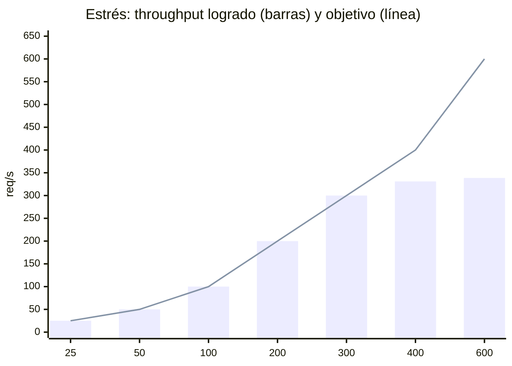

# 4.4.3 Pruebas de carga y estrés

Estas pruebas responden tres preguntas: cuánto tráfico sostiene PeaceApp con tiempos de respuesta aceptables (**carga**), en qué punto deja de hacerlo y qué componente cede primero (**estrés**), y si el clúster agrega réplicas cuando la demanda sube (**autoescalado**).

## Diseño

Se eligió **k6** 1.3. Los escenarios se escriben en JavaScript y se versionan junto a la suite, y k6 permite fijar la **tasa de llegada** de peticiones por segundo, en lugar de un número de usuarios que esperan cada respuesta antes de enviar la siguiente. Con una tasa fija, si el sistema se vuelve lento las peticiones se siguen acumulando como en la realidad, y la degradación no queda oculta.

**Mezcla de tráfico.** Cada iteración representa una acción de un vecino con sesión iniciada. La proporción sigue el uso esperado de la web: sobre todo consultas del mapa y del listado, y pocas publicaciones.

**Tabla 9**  
*Mezcla de peticiones por iteración*

| Operación | Endpoint | Proporción |
|---|---|---|
| Listado de reportes | `GET /api/v1/incidents?page=0&size=12` | 30 % |
| Reportes del mapa (zona) | `GET /api/v1/incidents/map?minLat…` | 25 % |
| Mapa de calor | `GET /api/v1/incidents/heatmap?…&cellSize=0.01` | 15 % |
| Detalle de un reporte | `GET /api/v1/incidents/{id}` | 10 % |
| Alertas no leídas | `GET /api/v1/alerts/unread-count` | 12 % |
| Publicar un reporte | `POST /api/v1/incidents` | 8 % |

La publicación es la operación más cara para la plataforma. Además de escribir en PostgreSQL, emite el evento `incident.created`, que consumen los servicios de confianza, alertas y comunidad. Por eso las pruebas no solo miden la latencia HTTP: también muestrean cada 5 s la CPU de cada contenedor y los **mensajes pendientes en cada cola de RabbitMQ**.

**Tabla 10**  
*Escenarios*

| Escenario | Archivo | Perfil | Umbrales (gate) |
|---|---|---|---|
| Carga | `tests/perf/load.js` | 20 req/s constantes durante 3 min, equivalentes a unos 1200 vecinos activos que hacen una acción por minuto | p95 < 500 ms, p99 < 1000 ms, errores < 1 %, p95 < 800 ms por endpoint. Bloquea el workflow |
| Estrés | `tests/perf/stress.js` | Escalones de 25, 50, 100, 200, 300, 400 y 600 req/s; 30 s de rampa y 60 s de meseta cada uno | Informativo: p95 < 1500 ms y errores < 5 % marcan el escalón donde se degrada |
| Autoescalado | `peaceapp-infra/tests/autoscaling/autoscaling.js` | Contra producción: rampa de 2 min hasta 40 usuarios, meseta y bajada; máximo 15 min y 50 usuarios; solo lecturas | Se aborta solo si los errores superan el 10 % |

## Implementación

- `tests/perf/lib.js` contiene el `setup()` común: crea usuarios verificados (el código se lee del bus de eventos) y 30 reportes semilla, fuera de la medición. También contiene la mezcla de tráfico y el resumen.
- **Métricas limpias.** Las cifras se calculan sobre las submétricas del escenario (`{scenario:carga}`, `{scenario:estres}`), para que el registro y la verificación de usuarios del `setup()` no se mezclen con la medición.
- **Métricas por escalón.** En el estrés, cada petición lleva la etiqueta `stage` con la tasa objetivo de la meseta en curso. Así el resumen da p50, p95, p99 y errores por escalón sin exportar millones de puntos.
- `tests/perf/run.sh` ejecuta k6 en Docker dentro de la red del stack. En paralelo muestrea `docker stats` y la API de administración de RabbitMQ, y exporta el dashboard HTML de k6. `tests/perf/analyze.py` cruza las tres fuentes por escalón.

### Autoescalado (HPA) en AKS

El clúster de producción tenía réplicas fijas. Para esta prueba se agregó al chart `charts/service` de `peaceapp-infra` un **HorizontalPodAutoscaler** (`autoscaling/v2`), desactivado por defecto. Se activó solo en `api-gateway` e `incident-service`, que reciben el tráfico de lectura medido:

- Entre 1 y 3 réplicas, con un objetivo de 70 % de la CPU solicitada (100m por pod).
- Sube 1 pod cada 30 s sin ventana de estabilización y baja 1 pod cada 30 s tras 60 s estables, para que la bajada se vea dentro de la prueba.
- Con el HPA activo, el Deployment deja de fijar `replicas`; si no, cada `helm upgrade` desharía la decisión del HPA. El PodDisruptionBudget pasa a depender de `minReplicas`.
- Capacidad: 2 réplicas extra de 384 MiB caben en los 2 nodos `Standard_B2as_v2` junto al resto.

El workflow `autoscaling-test` es manual y solo corre desde `main`, porque la credencial federada de Azure está limitada a esa rama. El workflow:

1. Aplica el HPA con `helm upgrade`, usando la imagen que ya corre en el clúster.
2. Verifica que `metrics-server` responda.
3. Ejecuta k6 contra `https://api.peaceapp.angelanampa.dev` con una cuenta QA, mientras muestrea `kubectl get hpa` cada 10 s.
4. Espera 3 minutos a que el clúster desescale.
5. Publica una gráfica de réplicas frente a throughput y p95, y los eventos `SuccessfulRescale`.

`helm template` y `helm lint` validan el chart con y sin HPA, y `actionlint` valida el workflow.

## Ejecución

- **CI:** pasos "k6 carga (gate)" y "k6 estrés (informativo)" de `advanced-tests.yml`. Los resúmenes se agregan al resumen del job y los CSV y dashboards se publican como artefacto.
- **Local:** `bash tests/perf/run.sh load` y `bash tests/perf/run.sh stress`; con `RATE`, `DURATION`, `STAGES` y `STEP` se cambia el perfil.
- **Entorno de esta medición:** Docker Desktop con 12 CPU lógicas y 7,5 GB asignados, con los límites de memoria de `docker-compose.ci.yml` (512 a 640 MiB por servicio). k6 corrió en la misma máquina. La base de datos se reinició antes de la medición.

## Resultados

### Carga: 20 req/s durante 3 minutos

La prueba de carga pasó todos sus umbrales. Se enviaron 3600 peticiones a un ritmo de 20,0 req/s. No hubo errores ni iteraciones descartadas, y bastaron 20 usuarios virtuales simultáneos.

**Tabla 11**
*Resultado de la prueba de carga (20 req/s, 3 min)*

| Métrica | Valor | Umbral | Estado |
|---|---|---|---|
| Peticiones / throughput | 3600 / 20,0 req/s | — | — |
| Latencia p50 / p90 | 6,9 ms / 11,8 ms | — | — |
| Latencia p95 | 14,2 ms | < 500 ms | Cumple |
| Latencia p99 | 23,8 ms | < 1000 ms | Cumple |
| Latencia máxima | 400,8 ms | — | — |
| Errores HTTP | 0,00 % | < 1 % | Cumple |
| Iteraciones descartadas | 0 | < 10 | Cumple |
| p95 por endpoint | 10,4 ms (heatmap) a 18,3 ms (`POST /incidents`) | < 800 ms | Cumple |

La operación más lenta fue la publicación de un reporte (p95 de 18,3 ms), porque escribe en la base y registra el evento en el *outbox*. Las lecturas quedaron entre 10,4 ms y 14,0 ms. Las colas de RabbitMQ no acumularon mensajes: los tres consumidores de `incident.created` procesaron cada evento antes del siguiente muestreo.

### Estrés: escalones de 25 a 600 req/s

**Tabla 12**
*Resultado del estrés por escalón (meseta de 60 s)*

| Objetivo (req/s) | Logrado (req/s) | p50 (ms) | p95 (ms) | p99 (ms) | Errores | CPU más alta (promedio de la meseta) | Mensajes en cola (máx.) |
|---|---|---|---|---|---|---|---|
| 25 | 25,0 | 5,5 | 9,7 | 13,4 | 0 % | RabbitMQ 33 %, incident 9 %, gateway 9 % | 0 |
| 50 | 50,0 | 4,7 | 8,9 | 11,0 | 0 % | RabbitMQ 90 %, gateway 17 %, incident 16 % | 0 |
| 100 | 100,0 | 4,9 | 10,1 | 14,0 | 0 % | RabbitMQ 55 %, incident 30 %, gateway 21 % | 0 |
| 200 | 200,0 | 6,6 | 17,1 | 26,6 | 0 % | PostgreSQL 67 %, incident 64 %, gateway 49 % | 0 |
| 300 | 300,0 | 10,8 | 42,9 | 101,6 | 0 % | PostgreSQL 179 %, incident 110 %, gateway 72 % | 10 |
| **400** | **331,0** | **948,4** | **5372,6** | **7167,9** | 0 % | **PostgreSQL 468 %**, incident 184 %, gateway 129 % | 51 |
| 600 | 338,6 | 3107,0 | 4559,7 | 5450,3 | 0 % | PostgreSQL 517 %, incident 181 %, gateway 104 % | 49 |

*Nota.* El porcentaje de CPU es el de `docker stats`: 100 % equivale a un núcleo completo. Los escalones de 400 y 600 req/s no cumplen el umbral informativo de p95 < 1500 ms.

**Figura 6**
*Throughput logrado frente al objetivo en cada escalón (req/s)*

En total, la prueba de estrés envió 122 377 peticiones en 11 minutos, sin ningún error HTTP. Los resultados muestran tres cosas:

1. **Capacidad.** En este entorno la plataforma sostiene **300 req/s** con p95 de 42,9 ms. El **punto de quiebre está entre 300 y 400 req/s**: el throughput se estanca en unos 335 req/s y, a partir de ahí, cada petición extra solo espera en cola. En el escalón de 400 req/s el p95 sube de 43 ms a 5,4 s (125 veces más).
2. **La plataforma se degrada sin fallar.** Ninguna petición devolvió error ni se cortó por tiempo; las respuestas solo se volvieron más lentas. Como k6 mantiene la tasa de llegada, necesitó cada vez más usuarios virtuales para seguir enviando peticiones hasta llegar al límite de 1000. A partir de ahí no pudo iniciar 28 522 iteraciones (`dropped_iterations`). Esas iteraciones son la demanda que el sistema no alcanzó a atender, no errores del servidor.
3. **El cuello de botella es PostgreSQL.** Su CPU pasa de 0,7 núcleos a 200 req/s a 4,7 núcleos a 400 req/s (pico de 5,9). Le siguen `incident-service` (1,8 núcleos) y el gateway (1,3). RabbitMQ no limita: la cola más cargada (`trust.incident-created`) llegó a 82 mensajes y todas quedaron vacías al terminar la prueba (0 mensajes pendientes, según el muestreo de drenado).

Para encontrar la causa se repitió una ráfaga de 40 s a 350 req/s y se muestrearon las consultas activas en PostgreSQL. El resultado está en `evidencias/4.4.3/diagnostico-350rps.txt`:

- 26 de 45 consultas activas eran la del **mapa**. `GET /incidents/map` devuelve hasta 500 reportes completos de la zona, ordenados por fecha.
- 9 eran un `count(id)` de esa misma zona, que se **calcula y se descarta**. `mapPoints()` usa `findAll(spec, PageRequest)`, que devuelve un `Page`, y Spring Data ejecuta la consulta de conteo aunque solo se use `getContent()`.
- El plan de ejecución (`EXPLAIN ANALYZE`) recorre toda la tabla (`Seq Scan`, 11 269 filas). El índice `(latitude, longitude)` no se usa porque todos los reportes de prueba están en la misma zona de Lima y el filtro no descarta nada.

La carga de la base crece con el número de reportes: el 8 % de las iteraciones publica uno, así que la tabla pasó de 30 a unas 10 000 filas durante el estrés. Los escalones altos corrieron, por tanto, con más datos que los primeros. Esta condición es realista, porque el mapa de una zona concurrida se llena, pero conviene tenerla en cuenta al comparar escalones.

**Comparación con la primera ejecución.** Una ejecución anterior sobre una base con datos de pruebas previas (8931 reportes y 48 098 alertas) mostró otro efecto: el HTTP respondía bien, pero las colas siguieron procesando eventos varios minutos después del fin, porque cada cola tiene un solo consumidor. Por eso `run.sh` ahora registra la profundidad de las colas, y la ejecución definitiva parte de una base vacía.

**Alcance de las cifras.** Las pruebas corrieron en Docker Desktop: 12 CPU lógicas compartidas entre todos los contenedores y el propio k6. Producción tiene 2 nodos `Standard_B2as_v2` de 2 vCPU cada uno y PostgreSQL administrado, así que su punto de quiebre será distinto. La medición en AKS corresponde a la prueba de autoescalado.

### Autoescalado en AKS

**Pendiente de ejecución.** El HPA, la prueba y el workflow están implementados y validados con `helm lint`, `helm template` y `actionlint`. Para ejecutarlos falta el merge de `peaceapp-infra` a `main` y la cuenta QA de producción (ver *Pendientes que requieren al equipo*). Al ejecutarse, el workflow publica la gráfica de réplicas frente a throughput y p95, el tiempo hasta el primer escalado y el tiempo de vuelta a una réplica, que completarán esta sección.

## Oportunidades de mejora

- **Evitar el conteo descartado del mapa.** Cambiar `mapPoints()` a una consulta con límite que no cuente filas: `findBy(spec, q -> q.sortBy(...).limit(n).all())` o un método que devuelva `Slice`. Elimina una de cada cinco consultas activas observadas en la saturación.
- **Respuestas más livianas para el mapa.** El mapa solo necesita id, coordenadas, tipo, severidad y estado. Una proyección (`interface IncidentPin`) evita cargar y serializar 500 entidades completas por petición. Bajar el `limit` por defecto, o agrupar en el servidor cuando hay más de N puntos, reduce la carga en zonas concurridas.
- **Mapa de calor agregado en la base.** `heatmap()` trae hasta 20 000 coordenadas y las agrupa en Java. Un `GROUP BY floor(latitude / :cell), floor(longitude / :cell)` devuelve directamente las celdas, y un caché de 30 a 60 s por zona y tamaño de celda evitaría recalcularlo en cada visita.
- **Índice espacial.** Con PostGIS y un índice GiST sobre la ubicación, las consultas por zona dejan de recorrer la tabla cuando los reportes se distribuyen por la ciudad.
- **Volver a medir tras las mejoras.** Repetir el estrés con los mismos escalones para cuantificar el nuevo punto de quiebre, y agregar un umbral de regresión al gate de carga, por ejemplo p95 < 50 ms a 20 req/s.
- **Más consumidores por cola.** Configurar la concurrencia de los *listeners* de `trust`, `alerts` y `community` (por ejemplo `concurrency: 2-4`) para que un pico de publicaciones no deje eventos pendientes, como ocurrió en la primera ejecución.
- **Límite de tasa en el gateway.** La plataforma no rechazó peticiones en ningún escalón: un solo cliente puede saturar la base. Un `RequestRateLimiter` por usuario y por IP protegería al resto de usuarios (ver A06 en 4.4.4).
- **Estrés en un entorno equivalente a producción.** Ejecutar el estrés en un *namespace* de pruebas de AKS con recursos iguales a producción, para obtener un punto de quiebre extrapolable y ver al HPA reaccionar en el escalón donde hoy la base se satura.

## Referencias técnicas

Grafana Labs. (s. f.). *Open and closed models*. k6 Documentation. https://grafana.com/docs/k6/latest/using-k6/scenarios/concepts/open-vs-closed/

Grafana Labs. (s. f.). *Thresholds*. k6 Documentation. https://grafana.com/docs/k6/latest/using-k6/thresholds/

Kubernetes. (s. f.). *Horizontal Pod Autoscaling*. Kubernetes Documentation. https://kubernetes.io/docs/tasks/run-application/horizontal-pod-autoscale/

RabbitMQ. (s. f.). *Consumer prefetch and concurrency*. RabbitMQ Documentation. https://www.rabbitmq.com/docs/consumer-prefetch
