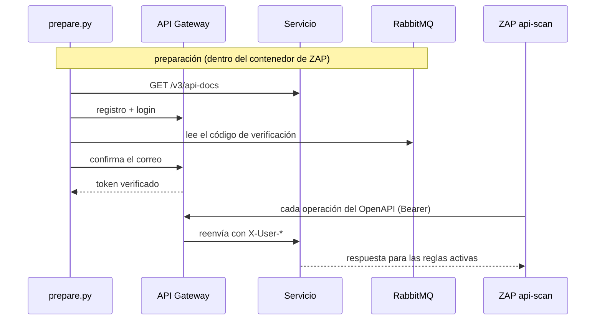

# 4.4.4 Pruebas de seguridad dinámicas (DAST) y OWASP Top 10

Las pruebas dinámicas de seguridad (DAST) atacan la aplicación en ejecución desde afuera, sin mirar el código, como lo haría un atacante. Complementan los controles estáticos que ya tenía el pipeline: SonarCloud (SAST), Gitleaks (secretos) y Trivy (vulnerabilidades de imágenes y dependencias).

## Diseño

Se usó **OWASP ZAP 2.16.1** desde su imagen oficial de Docker, conectada a la red del stack de Docker Compose. Se definieron tres escaneos con objetivos distintos:

**Tabla 13**  
*Escaneos de ZAP*

| Escaneo | Objetivo | Tipo | Autenticación | Cuándo corre |
|---|---|---|---|---|
| Baseline | Web (`http://web:8080`) | Pasivo: spider y AJAX spider (Firefox headless) que solo observan las respuestas | No | Cada ejecución del workflow |
| API scan | Las 5 APIs REST, **a través del gateway** | Activo: inyecciones, traversal, SSRF, etc. sobre cada operación del OpenAPI | `Bearer` de un usuario verificado distinto por servicio | Cada ejecución del workflow |
| Full scan | Web y su proxy `/api` | Activo sobre lo que encuentra el spider | No | Semanal o manual |

Decisiones de diseño:

- **El API scan entra por el gateway y no directo a los servicios.** Así se prueba lo que ve un atacante real: validación del JWT, propagación de identidad y CORS. Los OpenAPI se descargan de cada servicio dentro de la red y ZAP reescribe el servidor al gateway (`-O http://api-gateway:8080`).
- **Operaciones excluidas.** `DELETE /users/me` y `PUT /users/me/password` invalidarían el token a mitad del escaneo y el resto correría sin autenticación. Se excluyen del OpenAPI de identity y quedan cubiertas por sus pruebas de integración.
- **Política versionada (`tests/security/rules.tsv`).** Las reglas de riesgo alto (inyección SQL, XSS, ejecución remota, XXE, SSRF, Log4Shell, Spring4Shell y fuga del actuator) y las cabeceras ya corregidas están en `FAIL` y rompen el workflow. El resto queda en `WARN` y se reporta. Cada regla ignorada lleva su justificación.
- **Orden.** El escaneo activo crea datos basura, así que corre al final, después de las pruebas funcionales y de rendimiento.

**Figura 9**  
*Recorrido del API scan autenticado*



## Implementación

- `tests/security/zap.sh baseline|api|full`: ejecuta el escaneo pedido con la imagen fijada y deja HTML, JSON y Markdown en `tests/security/reports/`. Si ZAP sale con código 3 (no llegó a escanear, por ejemplo porque su proxy no pudo tomar el puerto elegido), reintenta una vez; ese caso ocurrió en la primera corrida local.
- `tests/security/prepare.py`: corre dentro del contenedor de ZAP. Crea un usuario verificado por servicio, descarga y filtra los OpenAPI y deja los tokens en un archivo temporal que se borra al terminar, aunque el script se interrumpa.
- `tests/security/rules.tsv`: política de reglas.
- `tests/security/false-positives.tsv` y `hooks.py`: falsos positivos revisados a mano. Cada línea indica regla, URL y parámetro, con su justificación. El *hook* los registra en ZAP como *alert filter*, de modo que la alerta baja a informativa solo en esa instancia y la regla sigue en `FAIL` para el resto de la API.
- Correcciones en `PeaceApp-AppWeb`: se agregó **Content-Security-Policy**, se restringió **Permissions-Policy** y nginx dejó de publicar su versión (`server_tokens off`).
- Correcciones en `identity-service` e `incident-service`, producto del API scan (ver *Resultados*).

La CSP se construyó a partir de los orígenes que realmente usa la web: Mapbox (estilos, tiles, telemetría y un *worker* creado desde `blob:`), Cloudinary (subida y lectura de la foto de perfil) y Azure Blob (subida y lectura de evidencias). Para que una CSP demasiado estricta no rompa el mapa sin aviso, se agregó `tests/e2e/specs/agnostic/csp.spec.js`. Esa prueba verifica la cabecera y recorre las pantallas principales en Chromium y Firefox registrando cualquier evento `securitypolicyviolation`.

## Ejecución

```bash
bash tests/security/zap.sh baseline   # pasivo sobre la web
bash tests/security/zap.sh api        # activo y autenticado sobre las 5 APIs, vía gateway
bash tests/security/zap.sh full       # activo sobre la web; el más lento
```

- **CI:** los tres escaneos son los últimos pasos del workflow `advanced-tests.yml` de `peaceapp-platform`, después de k6. El baseline y el API scan corren en cada ejecución. El full scan corre en la ejecución programada de los lunes a la 01:00 de Lima, o a mano con la opción `zap_full`, porque agrega unos 25 minutos.
- **Gate:** una alerta de una regla en `FAIL` hace fallar su paso. Igual que en el resto de la suite, un fallo no detiene los demás pasos: el paso *Gate* del final lista los escaneos fallidos y marca la ejecución como fallida.
- **Evidencias:** los reportes HTML, JSON y Markdown de ZAP se publican en el artefacto `advanced-tests`, que se conserva 30 días, y el resumen de la ejecución muestra el resultado de cada escaneo.

## Resultados

El baseline y el API scan se corrieron dos veces contra el stack local: una antes de las correcciones y otra después. El full scan se corrió una vez, con las correcciones ya aplicadas. Las salidas completas están en `evidencias/4.4.4/` (`zap-baseline-antes/`, `zap-baseline/`, `zap-api-antes/` y `zap-api/`), con el reporte HTML, JSON y Markdown de ZAP y la consola de cada corrida.

### Baseline de la web

La primera corrida rompió el workflow por una regla en `FAIL`: la web no enviaba **Content-Security-Policy**. Además, la cabecera `Server` publicaba la versión exacta de nginx (`nginx/1.31.7`) en las 12 URL visitadas. Después de la corrección en `PeaceApp-AppWeb`, ninguna regla queda en `FAIL`.

**Tabla 14**  
*Alertas del baseline de la web antes y después de las correcciones*

| Alerta (id de ZAP) | Riesgo | Antes | Después | Tratamiento |
|---|---|---|---|---|
| CSP Header Not Set (10038) | Medio | 2 URL · `FAIL` | 0 | Corregido: CSP en nginx, verificada por `csp.spec.js` |
| Server Leaks Version Information (10036) | Bajo | 12 URL | 0 | Corregido: `server_tokens off` |
| CSP: style-src unsafe-inline (10055) | Medio | — | 4 URL | Aceptado. Aparece porque ahora existe la CSP; Vue y mapbox-gl escriben atributos `style` (ver *Oportunidades de mejora*) |
| Insufficient Site Isolation Against Spectre (90004) | Bajo | 11 URL | 11 URL | Pendiente: faltan `Cross-Origin-Resource-Policy` y `Cross-Origin-Opener-Policy` |
| Information Disclosure - Suspicious Comments (10027) | Informativo | 1 | 1 | Falso positivo: la palabra `from` dentro del *bundle* minificado de Vite, no un comentario |
| Non-Storable / Cacheable Content (10049) | Informativo | 10 | 10 | Política de caché deliberada: *assets* con *hash* por un año, `index.html` con `no-cache` y `config.js` con `no-store` |
| ZAP is Out of Date (10116) | Informativo | 1 | 1 | La imagen está fijada en 2.16.1 a propósito, para que las corridas sean comparables |
| **Totales de la consola** | | **FAIL 1 · WARN 5 · PASS 60** | **FAIL 0 · WARN 5 · PASS 61** | |

Agregar la CSP no rompió la web: la suite E2E registró 0 violaciones de la política en Chromium y Firefox (4.4.1), y con la cabecera activa Lighthouse dio entre 96 y 100 en buenas prácticas en las 7 pantallas (`lighthouse-con-csp-summary.json`).

### API scan autenticado

ZAP atacó **64 operaciones** de las cinco APIs a través del gateway, cada una con un usuario verificado propio. En cada servicio se evaluaron 116 reglas activas y pasivas. **Ninguna regla de inyección** (SQL en sus siete variantes, XSS reflejado y persistente, comandos del sistema, XXE, SSTI, *Expression Language*, XPath, SSRF, Log4Shell ni Spring4Shell) levantó alertas en ningún servicio.

**Tabla 15**  
*Resultado del API scan por servicio*

| Servicio | Operaciones | FAIL antes → después | Respuestas 500 antes → después | WARN después | Reglas en PASS después |
|---|---|---|---|---|---|
| identity-service | 18 (2 excluidas) | 1 → 0 | 2 → 0 | 3 | 113 |
| incident-service | 11 | 0 → 0 | 1 → 0 | 3 | 113 |
| trust-service | 5 | 0 → 0 | 0 → 0 | 2 | 114 |
| alerts-service | 10 | 0 → 0 | 0 → 0 | 3 | 113 |
| community-service | 20 | 0 → 0 | 0 → 0 | 3 | 113 |
| **Total** | **64** | **1 → 0** | **3 → 0** | | |

El escaneo encontró tres problemas. Dos eran defectos reales y se corrigieron; el tercero era un falso positivo:

1. **Un NUL en la entrada producía un error 500 (A10:2025).** ZAP envió `%00` en el correo de `POST /auth/login` y de `GET /users/lookup`, y en el parámetro `q` de `GET /incidents`. PostgreSQL rechaza ese carácter (SQLSTATE 22021) y la excepción llegaba al cliente como 500. No era una inyección, porque las consultas son parametrizadas, pero sí un manejo incorrecto de una condición excepcional. En `identity-service` e `incident-service` ese error ahora responde **400** con un mensaje genérico. Cualquier otro error de integridad sigue siendo 500, pero sin exponer el SQL, y queda en el log.
2. **El cambio de correo aceptaba direcciones inválidas (A06 y A07).** ZAP no lo marcó como alerta. Apareció al revisar los efectos secundarios del escaneo: en la DLQ `notifications.email-requested.dlq` quedaron tres códigos de verificación dirigidos a `''`, `zj{@7533*3107}zj` y `zaproxy@example.com'` (`evidencias/4.4.4/dlq-correos-invalidos.txt`). La anotación `@Email` de Bean Validation acepta la cadena vacía y esas direcciones. Con `"email": ""` en `PUT /users/me`, la cuenta quedaba sin correo y el usuario ya no podía iniciar sesión. Ahora `EmailPolicy` exige una parte local con caracteres habituales y un dominio con al menos un punto, tanto en el registro como en el cambio de correo. Después de la segunda corrida, las seis DLQ tenían 0 mensajes (`evidencias/4.4.4/dlq-despues.txt`).
3. **Path Traversal en `PUT /users/me` (falso positivo).** La alerta era de confianza baja. ZAP mandó el último segmento de la URL (`me`) como `phoneNumber` y la respuesta fue igual a la original. Ese campo solo se guarda en una columna `varchar(20)` y nunca se usa para leer archivos (`AccountService.updateProfile`). Se registró en `false-positives.tsv` acotado a esa regla, esa URL y ese parámetro, así que Path Traversal sigue en `FAIL` para el resto de la API.

Quedan en `WARN`, sin romper el workflow, dos alertas de riesgo bajo:

- **Unexpected Content-Type (100001), en los cinco servicios.** Algunas rutas que ZAP prueba por su cuenta, fuera del OpenAPI (`/`, `/api`, `/api/v1` o prefijos como `/api/v1/admin`), reciben del gateway una respuesta en HTML en lugar de JSON. Lo coherente es que el gateway responda `ProblemDetail` en todas las rutas.
- **Insufficient Site Isolation Against Spectre (90004), en cuatro servicios** (no aparece en trust-service). Las respuestas de la API no envían `Cross-Origin-Resource-Policy`. Se puede agregar con un filtro global en el gateway y en nginx para la web, que tiene la misma alerta (Tabla 14).

### Full scan de la web

**Pendiente de ejecución.** El full scan está implementado (`zap.sh full`) y forma parte de la corrida semanal del workflow, pero no se completó en local. En tres intentos del 26 de noviembre, Docker Desktop dejó de responder a mitad del escaneo (`error waiting for container: unexpected EOF`) y el contenedor de ZAP terminó sin escribir reportes. La causa más probable es la memoria: la máquina virtual de Docker ya usaba unos 7,4 GB, y el escaneo activo con el AJAX spider de Firefox es el paso más pesado de la suite. Los resultados se tomarán de la primera ejecución programada en GitHub Actions, que corre en un runner dedicado. Mientras tanto, el baseline revisó de forma pasiva las mismas pantallas (login y registro) y el API scan atacó de forma activa las 64 operaciones. Lo que falta es el ataque activo sobre las pantallas de la web y su proxy `/api`.

## Revisión OWASP Top 10:2025

La tabla cruza cada categoría del OWASP Top 10:2025 con la evidencia obtenida en estas pruebas o en los controles existentes.

**Tabla 17**  
*Revisión de PeaceApp frente al OWASP Top 10:2025*

| Categoría | Controles y evidencia | Estado | Acción o mejora |
|---|---|---|---|
| **A01:2025 Broken Access Control** | El gateway valida el JWT y **reemplaza** las cabeceras `X-User-*` que envía el cliente. Roles verificados en el humo de API: un ciudadano no cambia roles, no ve la cola de moderación ni resuelve denuncias (403). Se agregaron 4 pruebas de caja negra: otro usuario no edita ni borra un reporte ajeno, y un `X-User-Id` o `X-User-Role` falsificado no da acceso (403). Los SAS de Blob tienen el mínimo privilegio, comprobado con Azurite (4.4.2). CORS rechaza orígenes no autorizados. | Controlado | Extender las pruebas de objeto ajeno a comentarios y contactos |
| **A02:2025 Security Misconfiguration** | ZAP baseline: faltaba la CSP y nginx publicaba su versión (ambos corregidos, Tabla 14). En producción el actuator solo expone `health` sin detalles; `prometheus`, `env` y `/v3/api-docs` responden 401. Los errores no incluyen mensaje, traza ni detalles de validación (`include-*: never`). HSTS está activo en producción. | Corregido | Agregar `Cross-Origin-Resource-Policy` y `Cross-Origin-Opener-Policy` (90004) y respuestas `ProblemDetail` en las rutas desconocidas del gateway (100001) |
| **A03:2025 Software Supply Chain Failures** | Trivy analiza imágenes y dependencias en cada pipeline. Gitleaks busca secretos. Dependabot está activo en los 11 repositorios. Las *actions* están fijadas por SHA y las imágenes de prueba por versión (ZAP 2.16.1, k6 1.3.0, Azurite 3.35.0). | Controlado | Generar SBOM y firmar imágenes (cosign) con verificación en AKS |
| **A04:2025 Cryptographic Failures** | TLS en el ingress con HSTS de un año (`includeSubDomains`). Contraseñas con BCrypt. JWT HMAC cuyo algoritmo (HS256, HS384 o HS512) depende del largo del secreto. Los SAS solo valen por HTTPS. | Controlado | Migrar el JWT a firma asimétrica (RS256/ES256) para que el gateway no tenga el secreto de emisión |
| **A05:2025 Injection** | ZAP API scan activo sobre 64 operaciones autenticadas (inyección SQL, XSS, comandos, XXE, SSTI, SSRF). JPA con consultas parametrizadas y Bean Validation en los DTO. Vue escapa la interpolación por defecto. Resultado: 0 alertas de inyección en los cinco servicios (Tabla 15). | Controlado | Correr el API scan en cada PR de servicio para detectar regresiones antes del merge |
| **A06:2025 Insecure Design** | El correo debe estar verificado para publicar, votar o comentar. El reenvío del código tiene límite (429). El autor no puede votar su propio reporte. Las evidencias pasan por saneamiento antes de publicarse. Hay ventana de edición y moderación por confianza. | Controlado | No hay *rate limiting* general en el gateway: en la prueba de estrés un solo cliente sostuvo cientos de peticiones por segundo sin ser frenado (4.4.3) |
| **A07:2025 Authentication Failures** | Bloqueo de cuenta tras intentos fallidos (`AccountLockedException`). MFA TOTP con códigos de recuperación. El token de recuperación es de un solo uso. La política de contraseñas rechaza claves débiles. El API scan mostró que `@Email` aceptaba un correo vacío, que dejaba la cuenta sin forma de iniciar sesión: se corrigió con `EmailPolicy` en el registro y en el cambio de correo. "Olvidé mi contraseña" responde 202 aunque el correo no exista, para no revelar cuentas. | Controlado | El token se guarda en `localStorage`: un XSS lo robaría. La CSP reduce ese riesgo; una cookie `HttpOnly` lo eliminaría |
| **A08:2025 Software or Data Integrity Failures** | Patrón *outbox* para publicar eventos. `Idempotency-Key` en Resend. DLQ por cola. El SAS de subida no permite escribir en el contenedor saneado, así que la evidencia publicada siempre pasa por la función de saneamiento (probado con Azurite). | Controlado | Firmar o validar el esquema de los eventos de RabbitMQ entre servicios |
| **A09:2025 Security Logging and Alerting Failures** | `X-Request-Id` viaja del gateway a los cuatro servicios (verificado en el humo de API). Bitácora de auditoría de incidentes. Los logs no incluyen secretos. | Parcial | No hay alertas sobre eventos de seguridad (picos de 401/403, bloqueos de cuenta). Centralizar los logs en Azure Monitor con reglas de alerta |
| **A10:2025 Mishandling of Exceptional Conditions** | Las pruebas encontraron y corrigieron tres manejos incorrectos de errores: los reintentos de Resend ante timeout o conexión cortada; el error de Cloudinary mostrado como falla del servidor; y la excepción de WebGL que impedía publicar (4.4.1 y 4.4.2). Respuestas `ProblemDetail` sin trazas. | Corregido | Pruebas de caos sobre RabbitMQ y PostgreSQL (caída y recuperación) |

## Oportunidades de mejora

- **Rate limiting en el gateway.** Spring Cloud Gateway ofrece `RequestRateLimiter` con Redis. Un límite por IP en `/auth/login` y `/auth/register` y otro por usuario en las escrituras cerrarían la brecha de A06 y A07, que hoy solo cubren el bloqueo de cuenta y el límite de reenvío del código.
- **Sesión en cookie `HttpOnly`.** Mover el token de `localStorage` a una cookie `HttpOnly; Secure; SameSite=Strict` emitida por el gateway, con protección CSRF.
- **Full scan autenticado de la web.** El full scan recorre la web sin sesión, así que solo ve el login y el registro. Un contexto de ZAP con *script-based authentication* que escriba el token en `localStorage` permitiría escanear las pantallas internas.
- **CSP más estricta.** `style-src 'unsafe-inline'` se mantiene porque Vue y mapbox-gl escriben atributos `style`. Se puede pasar a *nonces* o *hashes* una vez que se mida el impacto en el mapa. Además, `report-to` permitiría recibir las violaciones que ocurran en producción.
- **ZAP en cada PR de servicio.** El baseline y el API scan del servicio modificado tardan pocos minutos y detectarían regresiones antes del merge, no solo en la corrida semanal.

## Referencias técnicas

OWASP Foundation. (2025). *OWASP Top 10:2025*. https://top10.owasp.org/2025/

OWASP ZAP. (s. f.). *ZAP Docker user guide*. https://www.zaproxy.org/docs/docker/

OWASP ZAP. (s. f.). *ZAP - API scan*. https://www.zaproxy.org/docs/docker/api-scan/

Mapbox. (s. f.). *Mapbox GL JS: CSP directives*. Mapbox Docs. https://docs.mapbox.com/mapbox-gl-js/guides/browsers-and-testing/#csp-directives

MDN Web Docs. (s. f.). *Content Security Policy (CSP)*. https://developer.mozilla.org/en-US/docs/Web/HTTP/Guides/CSP
