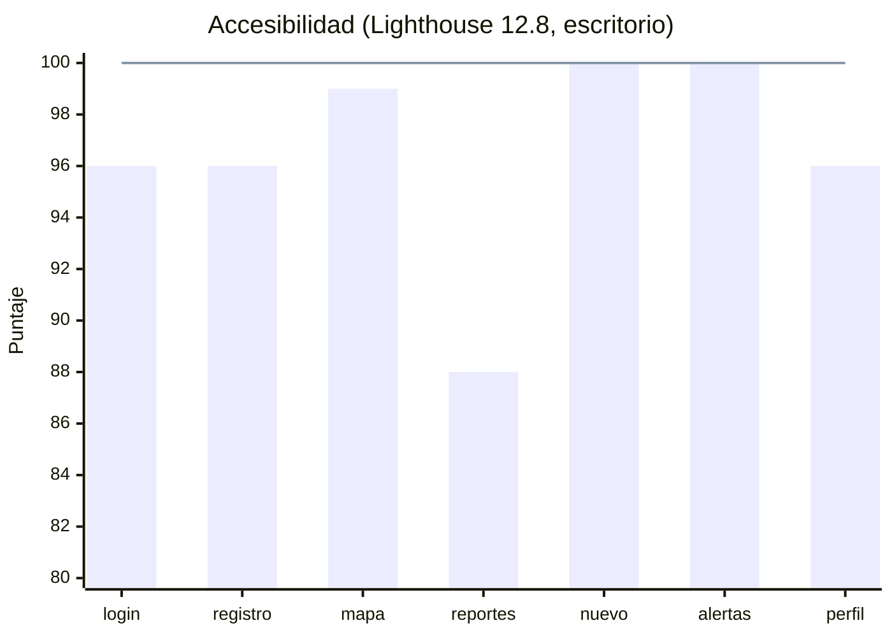

# 4.4.5 Pruebas de accesibilidad

PeaceApp está pensada para vecinos de cualquier edad y condición. Una persona con baja visión debe poder distinguir la severidad de un reporte, y quien navega con teclado o lector de pantalla debe poder publicar uno con evidencia. El objetivo de esta prueba es cumplir **WCAG 2.2 nivel AA** en las pantallas principales de la web.

## Diseño

Se combinaron dos herramientas automáticas y una revisión dirigida, porque las herramientas automáticas detectan solo una parte de los problemas de accesibilidad:

- **axe-core** (`@axe-core/playwright` 4.10) dentro de la suite de Playwright, en Chromium y Firefox. Se aplican las reglas de `wcag2a`, `wcag2aa`, `wcag21a`, `wcag21aa` y `wcag22aa` a 10 pantallas: login, registro, recuperar contraseña, mapa, listado de reportes, nuevo reporte, detalle, alertas, contactos y perfil. Se excluye el lienzo WebGL del mapa (`.mapboxgl-canvas`), que no tiene contenido accesible por definición. **Gate:** cero violaciones de impacto `critical` o `serious`.
- **Lighthouse** 12.8 sobre 7 pantallas, con la sesión iniciada en el mismo perfil de Chromium y el preset de escritorio. El script verifica que la URL final sea la pantalla pedida; sin esa comprobación, Lighthouse terminaba auditando el login. **Gate:** puntaje de accesibilidad ≥ 90 en cada pantalla. Rendimiento, buenas prácticas y SEO solo se informan.
- **Revisión dirigida.** Cuatro pruebas escritas a partir de lo que axe no ve: el nombre accesible de la navegación, el estado de los filtros de alternancia, el anuncio del voto propio y la posibilidad de adjuntar evidencia solo con teclado.

El proceso fue: (1) medición base sobre `develop`; (2) correcciones en `PeaceApp-AppWeb`, rama `tests/pruebas-avanzadas`; (3) nueva medición con la misma suite; (4) comparación por pantalla.

## Implementación

`tests/e2e/specs/a11y/screens.spec.js` recorre cada pantalla con un usuario recién creado y guarda un JSON por pantalla y navegador con cada violación, su impacto, los criterios WCAG y los selectores afectados. `tests/a11y/lighthouse.mjs` abre un perfil persistente de Chromium y escribe el localStorage de la sesión, para que Lighthouse audite la pantalla autenticada. Simula Mapbox igual que los E2E y guarda el reporte HTML y JSON de cada pantalla junto con un `summary.json`.

## Hallazgos y correcciones

**Tabla 20**  
*Hallazgos de accesibilidad y su corrección*

| Hallazgo | Detectado por | Criterio WCAG | Corrección |
|---|---|---|---|
| Insignias de severidad y estado con contraste insuficiente: blanco sobre naranja 3,08:1, sobre ámbar 2,26:1 y sobre gris 4,38:1 | axe, Lighthouse | 1.4.3 Contraste mínimo | Tonos más oscuros: ALTA #c2410c (5,18:1), MEDIA #8a5a00 (5,93:1), BAJA y VALIDADO #1e7a52 (5,30:1), PENDIENTE #5b6878 (5,68:1). El mapa de calor conserva sus tonos, porque no lleva texto encima |
| Texto de ayuda del login (#6b7d89, 4,27:1) y nivel de la contraseña (#c3d0da, 1,57:1) | axe | 1.4.3 | Se usa `--text-muted` (5,10:1) |
| Enlaces #1f79aa sobre el fondo de la página (4,42:1) | axe | 1.4.3 | Los enlaces usan `--brand-700` (6,98:1) |
| Botones de paginación sin nombre (solo un ícono) | axe (critical), Lighthouse | 4.1.2 Nombre, función, valor | `aria-label` "Página anterior/siguiente" en español e inglés |
| Barra de avance de votos sin nombre | axe | 4.1.2 | `aria-label` y `aria-valuemin` |
| Títulos de las tarjetas en `h3` justo después del `h1` | Lighthouse | 1.3.1 Información y relaciones | `h2` con el estilo visual de `h3` |
| Marcadores del mapa con `role="img"` sobre un `<button>` | Lighthouse | 4.1.2 | Se quita el rol que agrega mapbox-gl |
| El glifo de cada ícono se filtra al nombre accesible (el lector anuncia " Mapa") | Revisión dirigida | 2.5.3 Etiqueta en el nombre | `aria-hidden="true"` en 57 íconos decorativos de 19 componentes |
| Filtros "Todos / Mis reportes" y voto propio sin estado | Revisión dirigida | 4.1.2 | `aria-pressed` en filtros (reportes, mapa, alertas, administración) y en los botones de voto |
| "Subir imagen" no se alcanza con teclado (el input de archivo tenía `hidden`) | Revisión dirigida | 2.1.1 Teclado | El input queda visualmente oculto pero enfocable (`.sr-only`) y su etiqueta muestra el foco |
| Botones de comentario solo con `title` | Revisión de código | 4.1.2 | `aria-label` además de `title` |

Cada corrección quedó en el commit `5f7e913` de `PeaceApp-AppWeb`. Las 55 pruebas unitarias de la web siguen pasando y el build de producción compila.

## Ejecución

```bash
npx playwright test specs/a11y        # axe y revisión dirigida, Chromium y Firefox
node tests/a11y/lighthouse.mjs        # Lighthouse; termina con código 1 si alguna pantalla queda bajo 90
```

Ambas corren en el workflow `advanced-tests.yml` (sección 4.4.1) contra el stack de Docker Compose.

## Resultados

**Tabla 21**  
*Violaciones de axe con impacto critical o serious, en nodos afectados (iguales en Chromium y Firefox)*

| Pantalla | Antes | Reglas | Después |
|---|---|---|---|
| Listado de reportes | 25 (2 critical, 23 serious) | `button-name`, `color-contrast` | 0 |
| Detalle de reporte | 4 | `aria-progressbar-name`, `color-contrast` | 0 |
| Login | 1 | `color-contrast` | 0 |
| Registro | 1 | `color-contrast` | 0 |
| Perfil | 1 | `color-contrast` | 0 |
| Mapa, nuevo reporte, alertas, contactos, recuperar contraseña | 0 | — | 0 |
| **Total por navegador** | **32** | | **0** |

**Figura 12**  
*Puntaje de accesibilidad de Lighthouse por pantalla, antes y después de las correcciones*



*Nota.* Barras: antes. Línea: después.

**Tabla 22**  
*Puntajes de Lighthouse (escritorio) antes → después*

| Pantalla | Accesibilidad | Rendimiento | Buenas prácticas | SEO | LCP |
|---|---|---|---|---|---|
| Login | 96 → 100 | 98 | 100 | 83 | 1,08 s |
| Registro | 96 → 100 | 98 | 100 | 83 | 1,09 s |
| Mapa | 99 → 100 | 96 | 96 | 83 | 1,30 s |
| Reportes | **88** → 100 | 100 | 96 | 83 | 0,79 s |
| Nuevo reporte | 100 → 100 | 96 | 96 | 83 | 1,29 s |
| Alertas | 100 → 100 | 100 | 96 | 83 | 0,81 s |
| Perfil | 96 → 100 | 100 | 96 | 83 | 0,77 s |

Antes de las correcciones, el gate fallaba en el listado de reportes (88). Después, las 7 pantallas llegan a 100. Las 4 pruebas de la revisión dirigida fallaban antes y pasan después. La suite de accesibilidad completa (10 pantallas y 4 revisiones dirigidas, 14 pruebas por navegador) pasa en Chromium y Firefox.

## Oportunidades de mejora

- **Pruebas con personas y lectores de pantalla reales.** Las herramientas automáticas cubren una fracción de WCAG. Falta una sesión con NVDA (Windows) y TalkBack (Android) sobre los flujos de reportar y votar.
- **Alternativa textual al mapa.** El mapa WebGL no es accesible por naturaleza. El listado cumple esa función, pero no se puede filtrar por cercanía; agregar "cerca de mí" al listado daría una alternativa equivalente (WCAG 1.1.1).
- **Permiso de geolocalización al cargar.** Lighthouse lo marca en buenas prácticas (96). Conviene pedirlo cuando el usuario abre el mapa o publica, con una explicación previa.
- **SEO de las pantallas públicas** (83): falta `meta description` y `/robots.txt` cae en el fallback de la SPA. Solo afecta al login y al registro.
- **Gate en cada PR de la web.** Hoy axe y Lighthouse corren en `peaceapp-platform`. Una versión reducida (axe sobre `vite preview` con la API simulada) en el pipeline de `PeaceApp-AppWeb` detectaría regresiones antes del merge.

## Referencias técnicas

Deque Systems. (s. f.). *axe-core rule descriptions*. GitHub. https://github.com/dequelabs/axe-core/blob/develop/doc/rule-descriptions.md

Google. (s. f.). *Lighthouse accessibility scoring*. Chrome for Developers. https://developer.chrome.com/docs/lighthouse/accessibility/scoring

World Wide Web Consortium. (2023). *Web Content Accessibility Guidelines (WCAG) 2.2*. W3C Recommendation. https://www.w3.org/TR/WCAG22/
