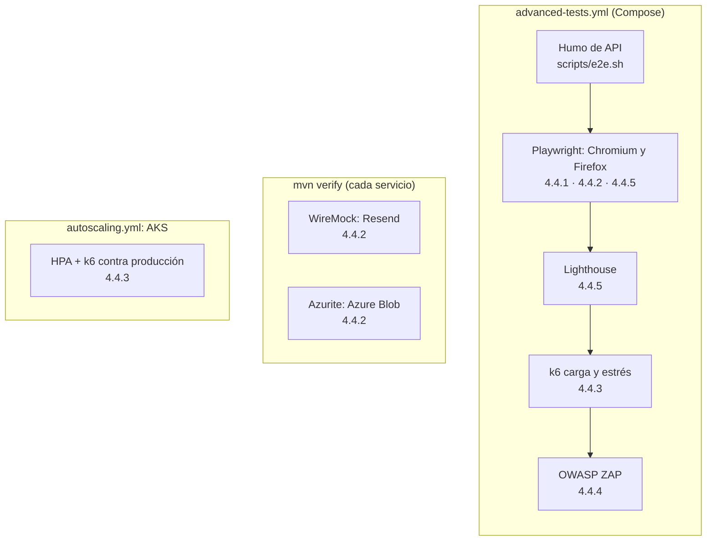

# 4.4 Pruebas avanzadas

Este directorio documenta la sección 4.4 del informe. Cada tipo de prueba se describe con su diseño, implementación, ejecución, resultados cuantitativos y oportunidades de mejora.

- [4.4.1 Pruebas end-to-end de navegador](4.4.1-e2e-navegador.md)
- [4.4.2 Pruebas de integración con servicios de terceros](4.4.2-integraciones-terceros.md)
- [4.4.3 Pruebas de carga y estrés](4.4.3-carga-estres.md)
- [4.4.4 Pruebas de seguridad dinámicas (DAST) y OWASP Top 10](4.4.4-dast-owasp.md)
- [4.4.5 Pruebas de accesibilidad](4.4.5-accesibilidad.md)
- [Evidencias de las ejecuciones](evidencias/)

Las figuras y tablas se numeran dentro de este complemento. Al incorporarlas al documento universitario deben recibir la numeración correlativa que les corresponda en el informe completo.

## Entorno de prueba

Todas las pruebas, salvo la de autoescalado, corren contra el stack completo de Docker Compose de `peaceapp-platform`: la web (nginx), el API Gateway, los seis microservicios de dominio, PostgreSQL 16 y RabbitMQ. Es el mismo conjunto de imágenes que se despliega en AKS, con el perfil `local`. En ese perfil el correo va a la consola y la documentación OpenAPI está habilitada; en producción está deshabilitada.

**Figura 1**  
*Dónde se ejecuta cada tipo de prueba*

## Resumen de resultados

**Tabla 0**  
*Resultados principales (ejecución local del 26 de noviembre de 2026)*

| Sección | Indicador | Resultado |
|---|---|---|
| 4.4.1 | Pruebas E2E en Chromium y Firefox | 70 casos, 67 aprobados, 3 omitidos por ser de otro navegador, 0 fallidos; 0 violaciones de la CSP |
| 4.4.2 | Integraciones con terceros | 6 (Resend) + 5 (Azure Blob) + 14 (navegador) aprobadas; 2 defectos corregidos |
| 4.4.3 | Carga sostenida de 20 req/s | p95 = 14,2 ms; 0 % de errores |
| 4.4.3 | Estrés hasta 600 req/s | Sostiene 300 req/s (p95 = 42,9 ms); punto de quiebre entre 300 y 400 req/s por CPU de PostgreSQL; 0 % de errores |
| 4.4.3 | Autoescalado en AKS | Pendiente: requiere merge a `main` y cuenta QA |
| 4.4.4 | ZAP baseline de la web | Alertas `FAIL` 1 → 0 (CSP agregada); versión de nginx oculta |
| 4.4.4 | ZAP API scan autenticado (64 operaciones) | 0 alertas de inyección; respuestas 500 3 → 0; 2 defectos corregidos y 1 falso positivo documentado |
| 4.4.5 | Violaciones axe critical o serious | 32 → 0 por navegador |
| 4.4.5 | Lighthouse accesibilidad | 88-100 → 100 en las 7 pantallas |

## Cumplimiento del enunciado

Cada punto del enunciado de la sección 4.4, con el lugar del informe donde se responde y la evidencia que lo sustenta. Las rutas de evidencia son relativas a la carpeta `docs/4.4-pruebas-avanzadas/` del repositorio `PeaceApp-Report`.

### Requisito general: diseño, implementación, ejecución, resultados y mejoras

Las cinco subsecciones tienen los apartados *Diseño*, *Implementación*, *Ejecución*, *Resultados* y *Oportunidades de mejora*.

- **Ejecución automatizada en el pipeline.** Todas las pruebas, salvo el autoescalado, son pasos del workflow `peaceapp-platform/.github/workflows/advanced-tests.yml`. Se ejecuta a mano, cada lunes a la 01:00 de Lima y en cada PR que toque la suite. El autoescalado tiene su propio workflow, `peaceapp-infra/.github/workflows/autoscaling.yml`. Ambos publican sus reportes como artefacto durante 30 días.
- **Estado.** Los resultados de este documento vienen de corridas locales con los mismos scripts del workflow. La primera ejecución en GitHub Actions depende del secreto `ORG_READ_TOKEN` (ver *Pendientes*).

### 4.4.1 Pruebas end-to-end y de navegador

1. **Pruebas browser-agnostic.** Se usó Playwright. Las pruebas que corren sin cambios en ambos navegadores están en `tests/e2e/specs/agnostic/` (acceso, reportes, comunidad y CSP), `third-party/` (terceros, 4.4.2) y `a11y/` (accesibilidad, 4.4.5). Detalle en [4.4.1, Tabla 1](4.4.1-e2e-navegador.md).
2. **Pruebas browser-specific.** Están en `tests/e2e/specs/specific/`. En Chromium se prueba la red lenta, con Slow 3G y CPU 4x por CDP. En Firefox se prueba la web con WebGL deshabilitado, con `firefoxUserPrefs`. Cada una se salta en el otro navegador con `test.skip` y el motivo anotado. Detalle en [4.4.1, Diseño y Tabla 1](4.4.1-e2e-navegador.md).
3. **Al menos dos navegadores.** Las pruebas corren en Chromium y Firefox: 70 casos, 67 aprobados, 3 omitidos por ser del otro navegador y 0 fallidos. Detalle en [4.4.1, Tabla 2](4.4.1-e2e-navegador.md).
4. **Defectos encontrados y corregidos.** Detalle en [4.4.1, Tabla 3](4.4.1-e2e-navegador.md).

Evidencia: [`evidencias/4.4.1/junit.xml`](evidencias/4.4.1/junit.xml), [`results.json`](evidencias/4.4.1/results.json), [`playwright-report.html`](evidencias/4.4.1/playwright-report.html) y [`humo-api.txt`](evidencias/4.4.1/humo-api.txt).

### 4.4.2 Pruebas de integraciones con terceros

1. **Servicios externos cubiertos.** Resend (correo), Azure Blob Storage (evidencias), Mapbox (mapas y geocodificación) y Cloudinary (foto de perfil). Detalle en [4.4.2, Tabla 4](4.4.2-integraciones-terceros.md).
2. **Mocks, stubs o emuladores.** Resend se reemplaza con un *stub* HTTP de WireMock: 6 escenarios, entre ellos timeout, conexión cortada, 429 y 5xx ([Tabla 5](4.4.2-integraciones-terceros.md)). Azure Blob se prueba contra el emulador Azurite: 5 escenarios de permisos del SAS ([Tabla 6](4.4.2-integraciones-terceros.md)). Mapbox, Cloudinary y Blob se simulan desde el navegador con `page.route` de Playwright: 14 escenarios ([Tabla 7](4.4.2-integraciones-terceros.md)).
3. **Resultados.** Detalle en [4.4.2, Tabla 8](4.4.2-integraciones-terceros.md). Se corrigieron 2 defectos: los reintentos de Resend y el mensaje de error de Cloudinary.

Evidencia: [`evidencias/4.4.2/`](evidencias/4.4.2/), con los reportes JUnit de las dos integraciones, las corridas en rojo y en verde de Resend ([`resend-red.txt`](evidencias/4.4.2/resend-red.txt), [`resend-green.txt`](evidencias/4.4.2/resend-green.txt)) y la mutación detectada por la prueba de Azurite ([`azurite-mutacion.txt`](evidencias/4.4.2/azurite-mutacion.txt)).

### 4.4.3 Pruebas de rendimiento

1. **Carga.** Se usó k6 a 20 req/s durante 3 minutos: p95 = 14,2 ms y 0 % de errores. Detalle en [4.4.3, Tabla 11](4.4.3-carga-estres.md).
2. **Estrés.** Escalones de 25 a 600 req/s: el sistema sostiene 300 req/s y el punto de quiebre está entre 300 y 400 req/s, por la CPU de PostgreSQL. Detalle en [4.4.3, Tabla 12 y Figura 6](4.4.3-carga-estres.md).
3. **Tiempos de respuesta y throughput.** p50, p90, p95, p99 y máximo por escenario y por endpoint, throughput logrado frente al objetivo, CPU por contenedor y mensajes en cola por escalón.
4. **Autoescalado.** **Pendiente de ejecución.** El HPA del chart, la prueba de k6 y el workflow están listos y validados con `helm lint`, `helm template` y `actionlint`. Para correrlo falta el merge de `peaceapp-infra` a `main` y la cuenta QA. Detalle en [4.4.3, Autoescalado en AKS](4.4.3-carga-estres.md).

Evidencia: [`evidencias/4.4.3/`](evidencias/4.4.3/), con el resumen y el dashboard de k6 ([`load-dashboard.html`](evidencias/4.4.3/load-dashboard.html), [`stress-dashboard.html`](evidencias/4.4.3/stress-dashboard.html)), la CPU por contenedor (`*-docker-stats.csv`), las colas (`*-queues.csv`, `stress-drain.csv`), el análisis por escalón ([`stress-analysis.md`](evidencias/4.4.3/stress-analysis.md)) y el diagnóstico a 350 req/s ([`diagnostico-350rps.txt`](evidencias/4.4.3/diagnostico-350rps.txt)).

### 4.4.4 Pruebas de seguridad

1. **DAST con OWASP ZAP.** Se usaron tres escaneos ([4.4.4, Tabla 13](4.4.4-dast-owasp.md)):
   - Baseline de la web: alertas en `FAIL` de 1 a 0 ([Tabla 14](4.4.4-dast-owasp.md)). Evidencia en [`zap-baseline-antes/`](evidencias/4.4.4/zap-baseline-antes/) y [`zap-baseline/`](evidencias/4.4.4/zap-baseline/).
   - API scan autenticado sobre 64 operaciones: 0 alertas de inyección y respuestas 500 de 3 a 0 ([Tabla 15](4.4.4-dast-owasp.md)). Evidencia en [`zap-api-antes/`](evidencias/4.4.4/zap-api-antes/), [`zap-api/`](evidencias/4.4.4/zap-api/), [`dlq-correos-invalidos.txt`](evidencias/4.4.4/dlq-correos-invalidos.txt) y [`dlq-despues.txt`](evidencias/4.4.4/dlq-despues.txt).
   - Full scan de la web: **pendiente**. Las tres corridas locales se interrumpieron porque Docker Desktop dejó de responder; se completará con la ejecución programada en GitHub Actions ([4.4.4, Full scan de la web](4.4.4-dast-owasp.md)).
2. **Defectos corregidos a partir del DAST.** Falta de CSP y versión de nginx expuesta (`PeaceApp-AppWeb`). Un NUL en la entrada que producía 500 (`identity-service` e `incident-service`). Correos inválidos aceptados (`identity-service`).
3. **Revisión OWASP Top 10:2025.** Las 10 categorías, con su evidencia, estado y acción. Detalle en [4.4.4, Tabla 17](4.4.4-dast-owasp.md). Evidencia de producción: [`prod-headers-antes.txt`](evidencias/4.4.4/prod-headers-antes.txt) y [`prod-actuator.txt`](evidencias/4.4.4/prod-actuator.txt).

### 4.4.5 Pruebas de accesibilidad

1. **Evaluación con axe y Lighthouse.** axe corre con `@axe-core/playwright` en Chromium y Firefox. Lighthouse 12.8.2 evalúa 7 pantallas.
2. **Análisis de resultados.** Cada hallazgo tiene su criterio WCAG 2.2 y su corrección. Detalle en [4.4.5, Tabla 20](4.4.5-accesibilidad.md).
3. **Correcciones medidas.** Las violaciones *critical* o *serious* de axe bajaron de 32 a 0 por navegador ([Tabla 21](4.4.5-accesibilidad.md)). El puntaje de accesibilidad de Lighthouse subió de 88-100 a 100 en las 7 pantallas ([Figura 12 y Tabla 22](4.4.5-accesibilidad.md)).

Evidencia: [`evidencias/4.4.5/antes/`](evidencias/4.4.5/antes/) y [`evidencias/4.4.5/despues/`](evidencias/4.4.5/despues/), con axe por pantalla y navegador, y el resumen y el reporte HTML de Lighthouse.

## Cambios realizados por repositorio

| Repositorio | Rama | Cambio |
|---|---|---|
| `peaceapp-platform` | `tests/pruebas-avanzadas` | Suite `tests/` (Playwright, Lighthouse, k6, ZAP), `docker-compose.ci.yml`, workflow `advanced-tests.yml`, nuevos controles de acceso y de entradas inválidas en `scripts/e2e.sh` |
| `PeaceApp-AppWeb` | `tests/pruebas-avanzadas` | Correcciones de accesibilidad, respaldo sin WebGL, error de Cloudinary, Content-Security-Policy y `server_tokens off` |
| `identity-service` | `tests/pruebas-avanzadas` | Un NUL en la entrada responde 400 en vez de 500; el cambio de correo y el registro exigen un formato válido |
| `notification-service` | `tests/pruebas-avanzadas` | Pruebas de Resend con WireMock y corrección de reintentos |
| `incident-service` | `tests/pruebas-avanzadas` | Pruebas de Azure Blob con Azurite, endpoint configurable y NUL en la búsqueda como 400 |
| `peaceapp-infra` | `tests/pruebas-avanzadas` | HPA en el chart, valores para `api-gateway` e `incident-service`, prueba y workflow de autoescalado |

## Pendientes que requieren al equipo

Estas tareas no se pueden completar desde un entorno local sin credenciales de la organización. Quedan preparadas para ejecutarse en cuanto se resuelvan:

1. **Secreto `ORG_READ_TOKEN` en `peaceapp-platform`.** Es un token *fine-grained* con permiso `Contents: read` sobre los repositorios de la organización. El workflow `advanced-tests.yml` lo necesita para clonar los servicios privados; sin él, falla en el primer paso con un mensaje explícito.
2. **Cuenta QA en producción.** Un usuario verificado, guardado como secretos `QA_EMAIL` y `QA_PASSWORD` en `peaceapp-infra`, para la prueba de autoescalado de solo lectura.
3. **Revisión y merge de las ramas** `tests/pruebas-avanzadas` a `develop` (y de `peaceapp-infra` a `main`). El workflow de autoescalado solo puede autenticarse en Azure desde `main`, porque la credencial federada está limitada a esa rama.
4. **Primera ejecución en GitHub Actions** de `advanced-tests.yml` y `autoscaling.yml`, para reemplazar en estas páginas los resultados locales por los del runner y registrar los identificadores de ejecución.
