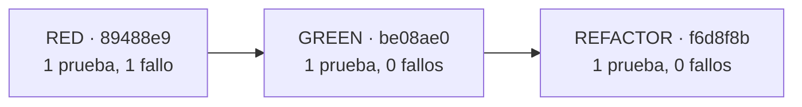
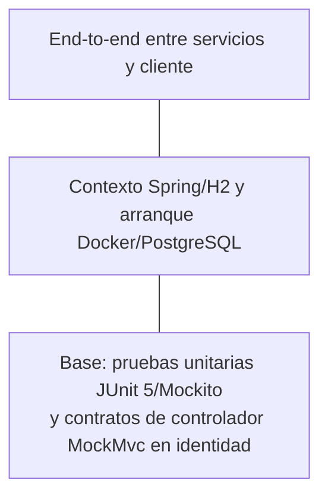
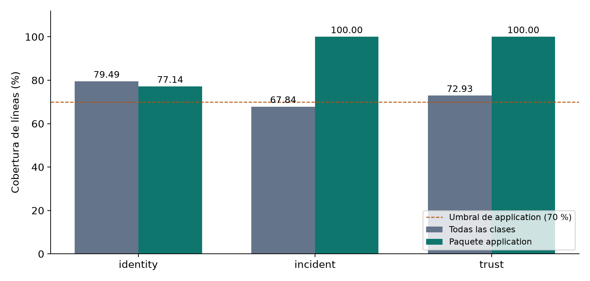

# 2.3 Agile Iterations

El análisis de las iteraciones comprende los requisitos refinados, los cambios de código y la verificación de identity-service, incident-service y trust-service. El corte de evidencia técnica es el 30 de octubre de 2026. La asignación a los sprints sigue el Product Backlog del informe y las fechas corresponden a los hitos técnicos registrados en el historial de versiones.

## 2.3.1 Requirements Thread

El refinamiento convierte las historias en comportamientos observables. En US-01 se consideran el registro válido, la detección de correo duplicado, el rechazo de contraseñas menores de ocho caracteres y la normalización del correo. El contrato HTTP de RegisterRequest usa @NotBlank, @Email y @Size(min = 8), mientras que AuthService aplica la regla de duplicidad y normalización. Esta separación permite comprobar la validación de entrada y la regla de negocio por separado.

**Tabla 1**  
*Trazabilidad de requisitos y comprobaciones automatizadas*

| Requisito | Criterio verificable | Evidencia en código |
| :--- | :--- | :--- |
| US-01 / CA-01 y CA-02 | El registro válido crea una cuenta; el correo existente se rechaza. | AuthServiceTest.registerCreatesUserWhenEmailIsNew y registerFailsWhenEmailAlreadyRegistered; AuthControllerTest.registerReturns201WhenDataIsValid. |
| US-01 / CA-03 | Dada una contraseña menor de ocho caracteres, al registrar, se devuelve HTTP 400 sin invocar al servicio. | AuthControllerTest.registerRejectsPasswordShorterThanEightCharacters. |
| US-01 / CA-04 | Dado Usuario@PeaceApp.pe, al registrar, se almacena usuario@peaceapp.pe. | AuthServiceTest.registerNormalizesEmailToLowercase y commits RED, GREEN y REFACTOR. |
| US-06 y US-08 | Crear con autor; aceptar evidencia de tamaño máximo; rechazar la que lo supera sin persistir. | IncidentServiceTest.createPersistsIncidentWithAuthor, acceptsEvidenceAtTheSizeLimit y rejectsOversizeEvidenceWithoutPersistingIncident. |
| US-09 y US-10 | Restringir edición/eliminación al autor y a la ventana permitida; consultar su historial. | IncidentServiceTest: controles de propiedad, ventana de edición, actualización, eliminación e historial. |
| US-14 a US-17 | Detectar duplicados, retener casos de alto riesgo, moderar y apelar dentro del plazo. | TrustServiceTest: evaluación, aprobación/rechazo y apelación con control de autor y plazo. |
| TS-02 y TS-03 | Compilar, ejecutar pruebas y cobertura; construir y arrancar cada servicio con PostgreSQL. | pom.xml, .github/workflows/maven.yml, Dockerfile, docker-compose.yml y evidencias por servicio. |

*Nota.* La trazabilidad cubre los casos nombrados; no implica que todas las historias hayan completado su Definition of Done. Los Issues US-01 (#3), US-02 (#8), TS-02 (#6) y TS-03 (#7) se encuentran en identity-service. El tablero y los acuerdos del equipo deben conservar el estado real de integración y aceptación.

## 2.3.2 Development Thread

### Test-Driven Development y Refactoring

La normalización del correo de US-01 dispone de tres commits del 9 de octubre de 2026 (hora de Lima): 89488e9, a las 17:19; be08ae0, a las 17:25; y f6d8f8b, a las 17:27. El 30 de octubre se volvió a ejecutar la misma prueba sobre copias aisladas de los tres commits. RED produjo un fallo de aserción: esperaba usuario@peaceapp.pe y obtuvo Usuario@PeaceApp.pe. GREEN y REFACTOR ejecutaron una prueba cada uno sin fallos. Los registros completos y tdd-verification.json acompañan esta sección.

**Figura 1**  
*Ciclo TDD reproducido para la normalización del correo*

*Nota.* Reproducción sobre los commits originales; no es una simulación del resultado.

La implementación mínima utiliza email.toLowerCase(Locale.ROOT) antes de consultar duplicidad y guardar el usuario. La refactorización extrae ese comportamiento al método privado normalizeEmail; mantiene el mismo resultado esperado.

### Simple Design

Los controladores reciben y validan datos HTTP; los servicios de aplicación coordinan reglas y repositorios; las entidades conservan estado de negocio. IncidentService concentra los controles de propiedad y plazo en getOwnedIncidentOrThrow y assertWithinEditWindow. TrustService separa el cálculo geográfico en GeoDistance y la evaluación de riesgo en falsenessScore. Esta estructura reduce repetición dentro de cada contexto y permite probar reglas con repositorios simulados. La heurística de falsedad sigue siendo provisional: no se presenta como un modelo de aprendizaje automático.

## 2.3.3 Testing Thread

La base de la pirámide utiliza JUnit 5 y Mockito para verificar reglas de negocio sin depender de una base de datos externa. Los casos MockMvc de identidad verifican el contrato de los controladores en modo standalone. Cada servicio añade una prueba de carga del contexto Spring con H2. Por encima de esos niveles, la comprobación de contenedores levanta el servicio con PostgreSQL 16 y consulta su salud. Esta última prueba verifica arranque y conectividad; no equivale a un flujo funcional completo entre microservicios.

**Figura 2**  
*Niveles de la estrategia de pruebas y estado de la evidencia*

La ejecución local de `mvn -B -ntp clean verify` completó 44 pruebas sin fallos ni errores: 20 en identidad, 11 en incidentes y 13 en confianza. El paquete application contiene los servicios que aplican las reglas de negocio; el umbral bloqueante implementado es 70 % de cobertura de líneas para ese paquete. El informe JaCoCo completo conserva también las métricas de todas las clases, sin excluir controladores ni seguridad.

**Tabla 2**  
*Resultados de pruebas y cobertura de JaCoCo*

| Microservicio | Pruebas | Fallos/errores | Instrucciones globales | Líneas globales | Ramas globales | Líneas application |
| :--- | ---: | ---: | ---: | ---: | ---: | ---: |
| identity-service | 20 | 0 | 78.32 % | 79.49 % | 50.00 % | 77.14 % |
| incident-service | 11 | 0 | 67.27 % | 67.84 % | 70.00 % | 100.00 % |
| trust-service | 13 | 0 | 73.97 % | 72.93 % | 73.53 % | 100.00 % |

*Nota.* Corte local del 30 de octubre de 2026. Los porcentajes globales y de application tienen denominadores diferentes. Incidentes alcanza el umbral de lógica de aplicación, pero su cobertura global de líneas es menor al 70 %. Los archivos jacoco.csv permiten recalcular las métricas; test-verification.json conserva los nombres de las suites y casos ejecutados.

**Figura 3**  
*Cobertura de líneas global y de la capa de aplicación*

*Nota.* Elaboración a partir de los CSV de JaCoCo incluidos. Las barras no representan cobertura de ramas ni cobertura funcional de los requisitos.

## 2.3.4 Ejecución de Sprints: Review y Retrospective

El Sprint 1 del backlog prioriza repositorios, CI, contenedores y autenticación. La secuencia técnica del 8 y 9 de octubre acredita la creación de identidad, las pruebas, el ciclo TDD y el workflow inicial. La validación del 30 de octubre amplía la cobertura y comprueba los tres servicios con PostgreSQL. Los hitos técnicos permiten seguir la evolución del incremento y preparar su demostración.

La Sprint Review permite inspeccionar el incremento frente a los criterios de aceptación. La demostración técnica dispone de una secuencia reproducible: ejecutar las pruebas, levantar Compose, consultar la salud de cada servicio y comprobar UID 100. Los reportes de pruebas y los artefactos de GitHub Actions sustentan los resultados del incremento.

La Sprint Retrospective se orienta a inspeccionar el proceso de trabajo y seleccionar mejoras. La revisión técnica de esta entrega permitió incorporar pipelines en incidentes y confianza, aplicar un control bloqueante de cobertura, conservar artefactos y comprobar los contenedores. Estos cambios concretos permiten evaluar la evolución de las prácticas de construcción y verificación del producto.

## Evidencias

- [Resultados y CSV por microservicio](evidencias/).
- [Reproducción del ciclo TDD](evidencias/tdd-verification.json), con registros RED, GREEN y REFACTOR.
- PR originales de identidad: #1 (pruebas), #2 (TDD), #10 (CI inicial), #11 (contenedor).
