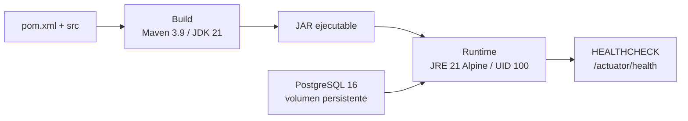

# 3.1 Contenedorización de microservicios

identity-service, incident-service y trust-service se empaquetan de forma independiente mediante imágenes Docker multietapa. La etapa de compilación utiliza Maven 3.9 y Java 21 para generar el JAR; la etapa de ejecución usa Eclipse Temurin 21 JRE Alpine. Se copia únicamente el artefacto de la aplicación y se asigna su propiedad a appuser. El proceso Java se ejecuta con UID 100, sin privilegios de administrador.

**Figura 4**  
*Construcción y ejecución independiente por microservicio*



Cada repositorio incluye Dockerfile, .dockerignore y docker-compose.yml. Compose inicia una base PostgreSQL propia por servicio y espera a que pg_isready confirme su disponibilidad antes de iniciar la aplicación. La separación de volúmenes mantiene independientes los datos de los tres contextos. Los puertos de aplicación son 8081, 8082 y 8083; los de PostgreSQL expuestos en el equipo son 5432, 5433 y 5434, respectivamente. Las credenciales incluidas son valores de desarrollo local y deben sustituirse al preparar un entorno externo.

El HEALTHCHECK consulta /actuator/health cada 30 segundos, con un tiempo máximo de 5 segundos, una espera inicial de 60 segundos y tres reintentos. El estado healthy se complementa con una consulta que comprueba status UP y con la lectura del usuario efectivo. La compilación Docker omite las pruebas porque el workflow las ejecuta previamente mediante Maven verify; construir una imagen por sí solo no demuestra que las pruebas hayan pasado.

**Tabla 3**  
*Validación local de los contenedores con PostgreSQL*

| Servicio | Puerto HTTP | Usuario efectivo | Estado del contenedor | Respuesta de salud |
| :--- | ---: | ---: | :--- | :--- |
| identity-service | 8081 | UID 100 | healthy | UP |
| incident-service | 8082 | UID 100 | healthy | UP |
| trust-service | 8083 | UID 100 | healthy | UP |

*Nota.* Resultados reales del 30 de octubre de 2026. Cada archivo container-verification.json identifica el servicio, el entorno, el tiempo transcurrido y las comprobaciones. Las tres imágenes se construyeron desde sus Dockerfile; se iniciaron con PostgreSQL 16 Alpine. Al finalizar se detuvieron las pilas de verificación, conservando sus volúmenes.

## Reproducción

Ejecutar en el repositorio del servicio:

```sh
mvn -B -ntp clean verify
docker compose up --build --wait --wait-timeout 180 -d
docker compose ps
docker compose exec -T incident-service id -u
docker compose exec -T incident-service wget -q -O - http://127.0.0.1:8082/actuator/health
docker compose down
```

El ejemplo corresponde a incident-service; para identidad o confianza se sustituyen el nombre y el puerto según la tabla. Para repetir una prueba no es necesario borrar los volúmenes. Las imágenes base usan etiquetas de versión; fijar su digest y escanear vulnerabilidades queda como mejora de reproducibilidad y seguridad.

## Alcance de la evidencia

La validación acredita construcción, arranque, conexión con PostgreSQL, salud y usuario de ejecución. No acredita escalabilidad, tolerancia a fallos, pruebas de carga o despliegue en una plataforma cloud. El entorno remoto y su evidencia deben incorporarse cuando estén disponibles.
