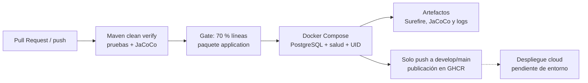

# 3.2 Pipelines as Code (CI/CD)

La automatización se define en .github/workflows/maven.yml de cada microservicio y se versiona junto al código. El workflow responde a Pull Requests dirigidas a develop o main, a cambios integrados en esas ramas y a la ejecución manual. La definición común establece Java 21, caché de Maven, un límite de tiempo y cancelación de ejecuciones anteriores de la misma referencia.

**Figura 5**  
*Flujo de integración y entrega de imágenes*

La tarea verify ejecuta Maven clean verify; una prueba fallida o una cobertura de líneas inferior al 70 % en application produce un fallo del job. El reporte JaCoCo conserva las métricas del conjunto completo de clases. Posteriormente se construye la imagen y se inicia con PostgreSQL mediante Docker Compose. El workflow exige contenedores saludables, UID 100 y respuesta UP del endpoint de salud. Estas comprobaciones amplían el CI inicial de identidad, que solo compilaba, ejecutaba pruebas y adjuntaba reportes.

Los artefactos conservan los resultados de Surefire, el reporte HTML/XML/CSV de JaCoCo, la respuesta de salud y el estado y registros de los contenedores durante 30 días. Los logs eliminan el valor de la contraseña de desarrollo generada automáticamente por Spring. Los pasos de recolección y limpieza se ejecutan también ante un fallo. La ausencia de archivos en la carga del artefacto provoca un error en lugar de ocultar la falta de evidencia.

La tarea publish depende del éxito de verify y se habilita únicamente para push a develop o main. Publica en GitHub Container Registry una etiqueta con el SHA completo del commit y otra con el nombre de rama. La etiqueta por SHA permite identificar la revisión utilizada; la etiqueta de rama cambia en cada integración. El token de GitHub se utiliza desde secrets.GITHUB_TOKEN, con permiso packages: write limitado a la tarea de publicación. Las Pull Requests no publican imágenes.

## Entrega continua y despliegue

El workflow automatiza la verificación y la publicación de imágenes verificadas tras integrar los cambios. El despliegue continuo en cloud permanece pendiente: se necesita definir la plataforma y el entorno, configurar credenciales de acceso, sustituir valores locales, desplegar la imagen por SHA y conservar la prueba de salud y la revisión desplegada. La publicación en un registro no se registra como despliegue remoto exitoso.

Para una reversión se debe seleccionar el SHA de una imagen anterior que haya superado la verificación, actualizar el entorno de ejecución a esa referencia y repetir las pruebas de salud y de negocio. Deben considerarse aparte las migraciones de base de datos; reemplazar una imagen no revierte sus datos.

## Evidencia y controles pendientes

Las comprobaciones locales de los tres microservicios se encuentran en evidencias/. La ejecución histórica de identidad del 9 de octubre (38001955510) corresponde al workflow inicial y no acredita la nueva verificación Docker ni un reporte de cobertura adjunto. Los resultados de la nueva ejecución se documentan desde las Actions de las PR de entrega; no se reutiliza una ejecución anterior como evidencia de archivos posteriores.

Antes de considerar cerrada TS-02, se requiere integrar las PR y comprobar los checks de GitHub. El cierre de la entrega cloud exige una ejecución real de publicación y despliegue. Como mejoras posteriores quedan las pruebas de contrato/end-to-end, el análisis de dependencias e imágenes y la configuración de checks obligatorios en las reglas de rama según los acuerdos del equipo. No se afirma que esos controles estén ya habilitados.

## Referencias técnicas

GitHub. (s. f.). *Publishing Docker images*. GitHub Docs. https://docs.github.com/en/actions/tutorials/publish-packages/publish-docker-images

GitHub. (s. f.). *Working with the Container registry*. GitHub Docs. https://docs.github.com/en/packages/working-with-a-github-packages-registry/working-with-the-container-registry

JaCoCo. (s. f.). *jacoco:check*. https://www.jacoco.org/jacoco/trunk/doc/check-mojo.html
